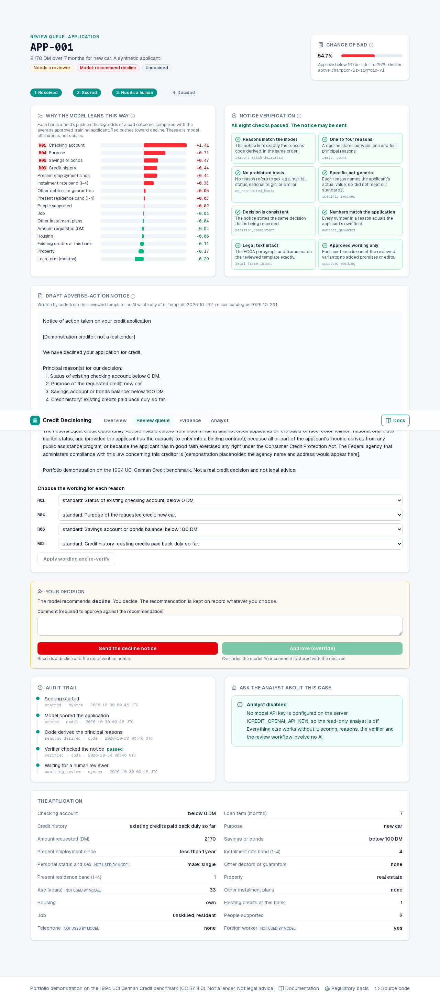

# Credit Decisioning

**When credit is declined, the applicant must be told the specific reasons. This project makes those reasons checkable.**



A calibrated logistic regression scores a consumer-credit application. **Code, not AI**, applies a cost-derived policy, derives the principal reasons from the model's coefficients, and writes the adverse-action notice from a reviewed template. A **separate code verifier** checks every notice with eight rules; a **mutation suite** proves those rules reject 14 kinds of defective notice. **A human decides.** Beside the product, a **read-only AI analyst** (LangChain `create_agent`) explains evidence and cases and drafts reports, and code checks every number it states.

> Portfolio demonstration on the 1994 UCI German Credit benchmark (1,000 applicants, CC BY 4.0). The queue holds 60 synthetic applicants derived from it. Not a lender. Not compliance or legal advice.

## What it shows

| | |
|---|---|
| **Verifier engineering** | V1–V8 in pure Python; 14 mutators applied to every genuine benchmark notice, each required to fail its *intended* check; a meta-mutation proves every check earns its place; an import contract proves no LLM library is on the decision path |
| **Honest ML** | Repeated 5×5 CV with pooled out-of-fold predictions, bootstrap CIs, both trivial baselines, a paired champion-vs-challenger comparison, and a threshold derived from the cost matrix rather than tuned |
| **Fairness disclosure** | Protected attributes excluded, then audited with small-n gaps shown as gaps, plus a proxy audit. Finding: under-25s fall below the 0.8 screen although age is not an input |
| **A useful, bounded agent** | Read-only tools, human approval before saving any report, a scope guard, call limits, and a grounding middleware that checks every number against tool results |
| **Review workflow** | Plain-code state machine with atomic claims (409 on double start or stale page), stored recommendation vs human decision, verified-hash binding before a notice can be sent |

## Results (run 2026-10-29)

All numbers are generated: see [docs/evidence/results.md](docs/evidence/results.md) for n, labels, scorer and uncertainty on each.

- Champion expected cost **0.541** [95% CI 0.488, 0.598] per applicant vs **0.70** for declining everyone (n = 1,000, UCI labels, out-of-fold, deterministic scorer).
- AUROC **0.780** [0.751, 0.810]; the boosted challenger's advantage, +0.012 [−0.003, 0.029], is not established.
- Verifier: every applicable mutant killed across 14 mutators on 1,006 genuine notices; 0 genuine notices rejected; 8 of 8 disabled checks detected. Scorer: deterministic code.
- Analyst guard rails: 19 / 19 scripted-stand-in cases (gated). A separate, ungated live run on `gpt-4o-mini` behaved correctly on 15 of 15 questions after fixes, with one answer flagged for a real number error (n = 15, single author: a smoke test, not a rate). See [the results](docs/evidence/results.md).

## Run it

```bash
make install
make run            # API :8000, web :3000
```

Optional: enable the analyst by creating `.env` with `CREDIT_OPENAI_API_KEY`. To reuse the clinical-care keys: `sed 's/^NAVIGATOR_/CREDIT_/' ../clinical_care_navigator/.env > .env`. Without a key everything except the analyst works.

```bash
make check          # lint, mypy --strict, import contracts, tests (≥ 90% coverage), eval gate
make reproduce      # retrain from the pinned data; evidence must match
```

## Layout

```text
src/credit/
  pipeline/    data (sha256-pinned), model, policy, evaluate, fairness, reasons/, scoring, train
  notice/      template rendering (no LLM)
  guardrails/  the notice verifier V1-V8 (pure code)
  workflow/    review state machine
  store/       SQLite: queue, events, report drafts
  readmodels/  read-only views for the API and the analyst
  analyst/     create_agent: tools, middleware, grounding, prompt
  api/         FastAPI routes, SSE for the analyst
evals/         mutations, analyst cases, gates.yaml, run.py
frontend/      Next.js: Home, Queue, Application, Evidence, Analyst
docs/          MkDocs: case study, how it works, evidence, ADRs, regulatory basis, deploy
```

## Documentation

[Case study](docs/case-study.md) · [How it works](docs/how-it-works/index.md) · [Evidence](docs/evidence/index.md) · [Honest limits](docs/evidence/limits.md) · [Regulatory basis](docs/regulatory-basis.md) · [ADRs](docs/decisions/index.md) · [Deploy](docs/deploy.md) · [Build plan](docs/PLAN.md)

Data: Hofmann, H. (1994). Statlog (German Credit Data). UCI Machine Learning Repository. https://doi.org/10.24432/C5NC77. See [NOTICE.md](NOTICE.md).
