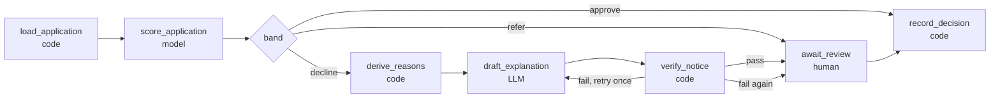

# B2 — Credit Decisioning Copilot: build plan

> **Status (2026-10-29): Stage A built.** This document is the original plan. The design was revised before building; the revision below **supersedes** any conflicting text further down (§§1, 5.3, 6, 8 and 10 in particular). What was built is described in [the docs](index.md) and the [ADRs](decisions/index.md).
>
> **Design revision (v3), user-directed:**
>
> - **No LangGraph.** The review workflow is a plain-code state machine over SQLite (ADR 0001), a deliberate exception to portfolio plan v4 §9.1.
> - **No LLM in the notice.** The notice is fully templated with reviewed wording variants; `chains/explain_reasons.py` and the oracle explainer are dropped (ADR 0003).
> - **All GenAI moves to a read-only analyst agent** built with LangChain `create_agent`, tools and middleware: evidence Q&A, case explanation, aggregate data queries and report drafts saved only after human approval, with a code grounding check on every number (ADR 0011, 0013).
> - **Corrections to this plan:** the cost inequality in §3.1 is reversed in the text (decline is cheaper when `1 − p < 5p`, i.e. `p > 1/6`; the value is right); prohibited terms are checked in reason text only because the ECOA paragraph must name them (V3/V7); numbers are checked per field (V6); the champion is unweighted (no double-counted costs); mutations report applicable/killed/skipped; fixtures are labelled single-author.
> - **Additions:** mutators M11–M14 (category swap, negation, zero-width character, unapproved variant); verified-hash binding before a notice can be sent; a refer case must `prepare_decline` before it can be declined.
> - **Not done (optional follow-ups):** a recorded live-model analyst run; public hosting; X4 extraction. `.env.example` could not be written in the build session (content-exclusion policy); variables are documented in `docs/deploy.md`.

*Written 2026-10-29 from `PORTFOLIO_PLAN_V4.md` (§0a, §6a, §9.5, §10.1, §13). Plan only: nothing in this folder has been built. This document is written so a fresh implementation conversation can start from it without any other context. Read `PORTFOLIO_PLAN_V4.md` §9 (shared project template), §9.5 (case-study standard) and §10.1 (UI and readiness standard), and `cohort_risk_lab/UI-ENHANCEMENT-GUIDE.md`, before Phase 0.*

---

## 0. Framing

### 0.1 What this is

A **decision-support copilot for consumer-credit adverse-action notices**. A trained, calibrated model scores a loan application. Code (not an LLM) derives the principal reasons for a decline. An LLM writes the plain-language explanation of those reasons. A **deterministic verifier** checks the notice before a human reviewer sees it. The human decides.

It is a *portfolio demonstration on a 1994 public dataset*, not a lending system. Say so on every page.

### 0.2 Why this project (portfolio role)

- **Finance is the underserved side of the portfolio.** Healthcare is already covered (A3, A12). B2 is the finance anchor for AI-evaluation and RL-environment contract work (`PORTFOLIO_PLAN_V4.md` G6).
- **The headline is verifier engineering, not model accuracy.** The claim worth making is: "here is a verifier for a regulated artefact, and here is the mutation suite proving it catches ten kinds of defective notice." That is the skill evaluators buy.
- **A genuinely different problem from A12.** A12 is a calibrated risk model with a *report*; B2 adds a *regulated output with a mandatory content rule* (specific reasons) and a *protected-class fairness audit*.
- **Reuses what exists** (A12's calibration and CI utilities; X2 `zarreh_agentkit`), so it is a build on proven parts, not a research project.

### 0.3 The honest limits (state them up front, in the README and on the Evidence page)

| Limit | Consequence |
|---|---|
| German Credit is **1,000 rows**, collected in Germany in the 1970s–90s, amounts in Deutsche Marks | Not representative of any current US lender or population. Metrics have wide confidence intervals |
| About **300 "bad" rows**; a 20% holdout holds about 60 | A single holdout would be noisy. The plan uses repeated stratified cross-validation and pooled out-of-fold predictions (§3) |
| The dataset has **no ground truth for "correct reason"** | Reason codes are *model attributions*, not facts about the applicant's behaviour. The verifier checks that the notice states the model's reasons faithfully, not that the model is right |
| The dataset has **no credit-bureau score** | FCRA score-disclosure content is out of scope and the notice template marks those fields "not applicable in this dataset" |
| Attribute A9 mixes sex and marital status | The sex-based fairness audit is limited to what A9 allows (§4.4). Say so |
| No live lender, no real applicants | Nothing here is compliance advice. Regulatory text must be re-checked against primary sources; a compliance review would be required before any real use |

### 0.4 What it demonstrates

| Capability | Where |
|---|---|
| Calibrated, cost-sensitive modelling on a tiny, imbalanced dataset, with honest uncertainty | §3, Phases 2–3 |
| Deterministic reason-code derivation under a legal specificity rule | §5, Phase 4 |
| A code-only verifier plus a **mutation-testing suite** for it | §7, Phase 5 |
| Protected-class fairness audit with small-n handling | §4, Phase 3 |
| Human-in-the-loop review with an explicit state machine | §6, Phase 6 |
| The 30-second-understanding UI and deployment-readiness standard | Phases 0, 7, 8, 10 |

---

## 1. Confirmed decisions

| # | Decision | Status |
|---|---|---|
| D-B2-1 | The decision (approve / refer / decline) is made **in code** from the calibrated probability and the cost-derived threshold. The LLM never sets it | Decided |
| D-B2-2 | Reason codes are derived **in code**; the LLM only paraphrases them | Decided |
| D-B2-3 | The notice verifier is **pure code**; an import-linter contract forbids `credit.guardrails` from importing any LLM library | Decided |
| D-B2-4 | Protected attributes are **excluded from model inputs** and audited afterwards; age is excluded too (conservative reading of Regulation B) | Decided |
| D-B2-5 | Model evaluation uses **repeated stratified 5×5 cross-validation with pooled out-of-fold predictions** (n=1,000) for metrics and the fairness audit; no single 20% holdout | Decided |
| D-B2-6 | Champion is a regularised logistic regression; challenger is gradient boosting. The champion is what runs. The challenger exists to **measure the cost of interpretability**, with a confidence interval | Decided |
| D-B2-7 | The CI gate has two layers: a **model gate** (floors recorded from the first run, never aspirational) and a **verifier gate** (mutation kill rate 100%, false-positive rate 0 on genuine notices) | Decided |
| D20 | X3 UI extraction timing (see `PORTFOLIO_PLAN_V4.md` §15) | **Open.** Until decided, copy `components/ui/` from A3 and record the duplication as debt in `docs/HARVEST.md` |
| Naming | Folder `credit_decisioning`, Python package `credit`, env prefix `CREDIT_`, hosted name `credit.zarreh.ai` (not deployed by this plan) | Decided; change only before Phase 0 |

---

## 2. Source material and licence

- **Dataset:** Statlog (German Credit Data), UCI Machine Learning Repository, dataset id 144 (via `ucimlrepo.fetch_ucirepo(id=144)` or the zip download). 1,000 rows, 20 attributes plus class. Licence is CC BY 4.0 as stated on the UCI page. **Confirm the licence and the citation text on that page before committing any copy** and put the citation in `NOTICE.md`.
- **Do not use the course copy** of the data (`Post_Graduate_Program_in_Artificial-Intelligence_Machine_Learning`): it is renamed, has fewer columns, and its provenance is unclear. Use the UCI original.
- **Class coding:** UCI uses 1 = good, 2 = bad. Recode once, in the loader, to `bad = 1` and test it.
- **Cost matrix (from the dataset documentation):** classifying a *bad* applicant as good costs **5**; classifying a *good* applicant as bad costs **1**. This is the project's decision-cost basis.
- **Attributes (UCI names, A1–A20):** checking-account status, duration (months), credit history, purpose, credit amount, savings, employment duration, instalment rate (% of disposable income), personal status and sex, other debtors/guarantors, present residence since, property, age, other instalment plans, housing, existing credits at this bank, job, number of dependants, telephone, foreign worker.
- **Synthetic demo queue:** a seeded `data/generate_applicants.py` produces about 60 *synthetic applicants* by resampling real rows and perturbing the numeric fields. They have **no labels** and are used only to populate the review queue; no accuracy claim is ever made on them. The real 1,000 rows are used for all metrics.

### 2.1 Protected and prohibited bases

| Attribute | Treatment | Reason |
|---|---|---|
| A9 personal status and sex | **Excluded** from the model. Used only to derive a sex-based audit group (§4.4) | Regulation B prohibits sex and marital status as a basis |
| A20 foreign worker | **Excluded**. Used in the audit as a national-origin proxy | National origin is a prohibited basis |
| A13 age | **Excluded** from the model; used for audit bands | Regulation B allows age in an *empirically derived, demonstrably sound* system if applicants 62+ are not treated less favourably. Excluding it is the conservative choice and the simplest to explain |
| A19 telephone | **Excluded** | Regulation B commentary addresses telephone listings; excluding avoids the question |
| Proxy risk | Reported, not assumed away: **proxy audit** (§4.3) measures how well the *remaining* features predict each excluded attribute | Dropping a column does not remove its correlates |

---

## 3. Data and validation design

1. **Loader** (`data/load_german_credit.py`): downloads once, caches under `data/raw/` (git-ignored), recodes labels and categories to readable values, asserts 1,000 rows, 20 attributes, 300 bad, no missing values. A tiny committed fixture (50 rows, stratified, fixed seed) is used by unit tests only.
2. **Resampling:** repeated stratified 5-fold cross-validation, 5 repeats, fixed seed. Every row receives 5 out-of-fold predictions from models that never saw it. **Pooled out-of-fold predictions** (mean per row across repeats, kept alongside the per-repeat values) drive all reported metrics and the fairness audit. This makes the smallest audit groups about three times larger than a single holdout would.
3. **Uncertainty:** percentile bootstrap (2,000 resamples of rows) for AUROC, expected cost per applicant, and each fairness metric. Also report the spread across the 5 repeats, to show model-selection noise separately from sampling noise. Always report n beside every number.
4. **Calibration:** calibrate inside each training fold (`CalibratedClassifierCV` with sigmoid for champion; isotonic is too hungry at 800 rows). Report reliability curve, Brier score and ECE on the pooled out-of-fold predictions. Calibration quality is what makes the threshold in §3.1 meaningful.
5. **Leakage control:** all preprocessing (encoding, scaling, binning) is fitted inside the fold via a single sklearn `Pipeline`; a test fits on fold A and asserts no statistic from fold B is used.

### 3.1 The decision threshold is derived, not searched

With costs of 5 (approve a bad applicant) and 1 (decline a good one), declining is cheaper than approving exactly when

$$1 - p > 5p \iff p > \tfrac{1}{6} \approx 0.167,$$

where *p* is the calibrated probability the applicant is bad. So:

- **Decline band:** *p* above a *refer* ceiling (default 0.25; a config value, documented as a reviewer-capacity policy, not a tuned number).
- **Refer band:** 0.167 ≤ *p* ≤ refer ceiling (borderline; goes to the human with no notice drafted until decided).
- **Approve band:** *p* < 0.167.

The threshold follows from the cost matrix, so there is no threshold sweep to overfit. A test asserts the code uses `1/(1+5)` computed from the configured costs.

### 3.2 The trivial baselines the model must beat

Per applicant, with 30% bad: *approve everyone* costs 0.30 × 5 = **1.50**; *decline everyone* costs 0.70 × 1 = **0.70**. Because of the 5:1 cost ratio, **declining everyone is cheaper than approving everyone.** The model must beat the *better* trivial policy (0.70) to be useful. Report the champion's expected cost per applicant against both baselines, with a confidence interval, and say plainly if the margin is small.

---

## 4. Fairness audit

Purpose: *measure and disclose*, not to certify. It runs on pooled out-of-fold predictions at the decision threshold from §3.1.

### 4.1 Groups

- **Sex group:** derived from A9. The original attribute has four values that mix sex and marital status. Use only what it supports: a *female* group and a *male* group, and state that the female group comprises a single A9 category and cannot be split by marital status.
- **National-origin proxy:** A20 foreign worker yes/no (the "no" group is small, about 4%; expect "insufficient n").
- **Age bands:** under 25, 25–39, 40 and over. The 62+ group is far too small to evaluate; say so and report n.

### 4.2 Metrics per group (each with bootstrap CI and n)

- Approval rate; adverse impact ratio (group approval rate ÷ highest group's approval rate), with the 80% rule shown as a **screening heuristic, not a legal standard**.
- False-positive rate (good applicant declined) and false-negative rate (bad applicant approved).
- Calibration within group (reliability gap), because a model can be calibrated overall and miscalibrated for a subgroup.
- Expected cost per applicant.

**Small-n rule.** A group with fewer than **30 applicants, or fewer than 10 of either class**, is reported as `insufficient n` with no point estimate. A test pins this rule. The Evidence page shows these as visible gaps, not omitted rows.

### 4.3 Proxy audit

For each excluded attribute (sex group, foreign worker, age band), train a small classifier on the *remaining* features and report cross-validated AUROC with a CI. An AUROC well above 0.5 means the permitted features still carry the attribute, so removal did not fully remove its influence. Report the result and what it does and does not imply.

### 4.4 Counterfactual invariance test (unit test, not a claim of fairness)

For every applicant, flip each excluded attribute and assert that the score, decision, and derived reasons are identical. This is true by construction when the columns are absent from the model input, so the test *guards against a future change that accidentally wires one back in*. Write it that way in the docs; do not present it as evidence of fairness.

---

## 5. Models and reason codes

### 5.1 Models

| Role | Model | Notes |
|---|---|---|
| **Champion (runs in the product)** | Logistic regression, L2, class-weighted, on one-hot categoricals and standardised numerics; sigmoid calibration | Reasons are exact from coefficients |
| Challenger | `HistGradientBoostingClassifier`, sigmoid-calibrated | Reasons would be approximate (SHAP). Not deployed. Exists to report the AUROC and expected-cost **difference** with a CI, i.e. the price of interpretability |
| Baselines | Approve-all, decline-all (§3.2) | Context |

Model selection is by expected cost per applicant on the out-of-fold predictions, not by AUROC. Report both.

### 5.2 Reason-code derivation (`pipeline/reasons/`)

1. For a declined applicant, compute each input attribute's contribution to the log-odds of "bad": for a logistic model, `coef × (x − x_ref)`, summed over the one-hot columns of the same original attribute, so reasons are per *attribute*, not per dummy column. The reference `x_ref` is the mean of applicants in the approve band (document this choice; Regulation B does not mandate a method).
2. Keep attributes whose contribution pushes *toward* decline. Rank by magnitude.
3. Return the **top four** (the CFPB's sample forms contemplate up to four principal reasons) mapped through `reasons.yaml` (a data file, version-controlled): reason code → required statement text → the application field(s) the statement must cite.
4. Ties and near-ties: a deterministic tiebreak by attribute name, tested.

**The reasons table is the single source of truth for specificity.** Each entry has a *required specificity rule* (for example "checking account status must be named", "loan duration in months must be stated"). The verifier uses the same table.

### 5.3 The LLM's only job

`chains/explain_reasons.py`: structured output, one plain-language sentence per reason code, in the applicant's language. Inputs are *only* the reason codes, the table's statements, and the application's own field values. It does not see the score, the threshold, or any protected attribute. A failing verifier triggers one retry with the failure list, then escalates to the reviewer as "explanation could not be verified".

---

## 6. Workflow (LangGraph) and human review



- **State machine for a review item** (owned in code, with the single-conditional-UPDATE claim from the guide): `queued → scoring → needs_review → (approved | declined | overturned) → recorded`, plus `failed`. Illegal transitions return 409; a test enumerates them.
- **The human always decides** on `refer` and `decline`. Approve-band applications are auto-recorded and clearly labelled *auto-approved, no review*. (An audit-sampling policy for auto-approvals is a production concern and is out of scope.)
- **Reviewer actions:** confirm the decline, overturn it to approve (with a required free-text reason), or edit the explanation text. **Edited text re-runs the verifier**; a notice that fails verification cannot be sent, and the UI says which check failed.
- **Checkpointing and replay:** durable checkpointer; the SSE progress stream replays stored events for finished runs.
- **Interrupts** use LangGraph `interrupt()` at `await_review`.

### 6.1 Notice structure

A notice is **template-framed**: the legal frame (statement of the decision, ECOA anti-discrimination statement, creditor name/address placeholders, the "not applicable in this dataset" lines) is filled from a static template by code. Inside the frame: the reasons' required statements (verbatim from `reasons.yaml`) and the LLM's plain-language gloss per reason. The LLM never writes the frame.

---

## 7. The notice verifier (`guardrails/notice_verifier.py`)

Pure Python; no network, no model. Returns a `VerificationReport` with one `Check(name, passed, detail)` per rule and an overall pass.

| # | Check | What it asserts |
|---|---|---|
| V1 | `reasons_match_derivation` | Reason codes in the notice equal `derive_reasons(...)` output: same set, same order |
| V2 | `reason_count` | 1–4 reasons on a decline; none on an approval |
| V3 | `no_prohibited_basis` | No term from the prohibited-basis list (sex, gender, marital, married, widowed, divorced, age/aged/years old, national origin, foreign, nationality, race, colour, religion, receipt of public assistance, and similar) appears in any notice text, and no reason code maps to a protected attribute. Term list is a data file with tests |
| V4 | `specific_reasons` | Each reason's text contains the specificity items its `reasons.yaml` entry requires (such as the account status or the duration), and **none** of the generic phrases the CFPB has said are insufficient ("did not meet our standards", "internal policy", "score too low", "insufficient points", "model output") |
| V5 | `decision_consistent` | Notice decision equals the model band's decision |
| V6 | `numbers_grounded` | Every number in the gloss appears in the application's own fields or in the template. No invented figures |
| V7 | `legal_frame_intact` | The template-filled frame text equals what the template produces for this decision (the LLM did not alter it) |
| V8 | `no_promises` | No conditional-approval language ("if you…we will approve") |

The verifier is the artefact the case study is about.

### 7.1 Mutation suite — proof the verifier works

`evals/mutations.py` takes each genuine verified notice from the validation set and applies one defect at a time, then asserts the verifier **fails the notice on the intended check**:

| Mutator | Defect injected | Expected failing check |
|---|---|---|
| M1 | Reorder two reasons | V1 |
| M2 | Drop the top reason | V1 |
| M3 | Append a fifth reason | V1, V2 |
| M4 | Insert a prohibited-basis phrase ("because of your age") into the gloss | V3 |
| M5 | Replace a reason with a generic phrase | V4 |
| M6 | Notice states "approved" on a decline | V5 |
| M7 | Insert a reason code not in the table | V1 |
| M8 | Change the stated loan duration to a different number | V6 |
| M9 | Remove the ECOA statement from the frame | V7 |
| M10 | Add "if you reapply with a co-signer we will approve" | V8 |

Gate: **kill rate 100% per mutator** (each caught by the intended check), and **0 false positives** on the unmutated genuine notices (n = number of validation declines, reported). A mutator that is not killed is a verifier bug. Include one *meta-mutation*: deliberately disable a check in the verifier and confirm `make eval` fails.

---

## 8. Architecture and layout

```
credit_decisioning/
  src/credit/
    api/          FastAPI routes, SSE, request/response models
    graph/        state.py, builder.py, nodes/{load_application,score_application,derive_reasons,
                  draft_explanation,verify_notice,await_review,record_decision}.py
    chains/       explain_reasons.py
    guardrails/   notice_verifier.py, prohibited_terms.yaml, notice_template.py
    pipeline/     features.py, train.py, calibrate.py, reasons/{derive.py,reasons.yaml}, fairness.py
    schemas/      application.py, notice.py, review.py
    store/        review_store.py (SQLite)
    prompts/      explain_reasons.md
    settings.py   observability.py
  data/           load_german_credit.py, generate_applicants.py, fixtures/
  evals/          run.py, canonical.py, mutations.py, oracle.py
  frontend/       Next.js (see Phase 7)
  docs/           (see Phase 9)
  tests/
  Makefile  pyproject.toml  Dockerfile  compose.yaml  compose.prod.yaml
  mkdocs.yml  NOTICE.md  README.md
```

Conventions (inherited from A2, A3, A12): Python 3.12, `uv`, `ruff`, `mypy --strict`, `import-linter`, `pytest`; one node per file; modules under about 200 lines; `zarreh-agentkit` pinned to the tag the sibling repos use.

**Import-linter contracts:**

1. Layers: `credit.api` → `credit.graph` → `credit.guardrails` / `credit.pipeline` → `credit.schemas`.
2. **Verifier is pure:** `credit.guardrails` and `credit.pipeline` may not import `langchain*`, `langgraph*`, `openai*` (mechanical proof of D-B2-3).
3. Chains never import nodes.
4. The decision threshold constant is imported only from one module.

**Oracle (stand-in explainer) for key-free CI:** `evals/oracle.py` builds each gloss mechanically from the reasons table (`"{statement}"` + the field value). This lets the whole graph, verifier and mutation suite run with no API key, and every published number labels its scorer as "scripted stand-in".

---

## 9. API (summary)

| Route | Purpose |
|---|---|
| `GET /applications` | Queue (status, band, created) |
| `GET /applications/{id}` | Detail: application fields, score band, reasons, verification report, notice draft, events |
| `POST /applications/{id}/score` | Start the pipeline; 404 unknown id; 409 if already claimed (atomic conditional UPDATE) |
| `GET /applications/{id}/events` | SSE progress; replays stored events for finished runs |
| `POST /applications/{id}/decision` | Reviewer action `{action, reason?, edited_text?}`; edited text re-verified; 409 on illegal transition |
| `GET /health` | Liveness |
| `GET /evidence` | Model metrics, fairness table and mutation results as committed JSON (no recomputation) |

Auth: Caddy basic auth in front (per the guide), plus the proxy-overwrites-`X-Forwarded-For` rule; no host ports published in `compose.prod.yaml`.

---

## 10. Phases

Each phase ends with its exit criteria green and a commit. Phases 0, 7, 8 and 10 carry the UI/readiness items from `PORTFOLIO_PLAN_V4.md` §10.1.

| Phase | Scope | Exit criteria |
|---|---|---|
| **0 — Scaffold, with the guide baked in** | Repo layout (§8), `pyproject.toml` with the contracts above, Makefile (`lint typecheck imports test eval data train docs run`), CI, `NOTICE.md`, README skeleton. **Frontend scaffold with `components/ui/` from A3** (`AppHeader`, `AppFooter`, `PageHeader`, `Card`, `Badge`, `Callout`, `InfoTip`, `Meter`), `lucide-react`, `lib/docs.ts`, `lib/glossary.ts`, dark mode from the first commit. Dockerfile, `compose.yaml`, `compose.prod.yaml`, `.dockerignore`, frontend Dockerfile (`ARG NEXT_PUBLIC_*`), `docs/deploy.md` skeleton | CI green on an empty skeleton; `docker compose build` works; one placeholder page renders in light and dark |
| **1 — Data** | Loader, recode, assertions, 50-row fixture, `generate_applicants.py` | Loader test asserts 1,000 / 20 / 300; fixture committed; synthetic queue reproducible from the seed |
| **2 — Models** | Pipeline, repeated stratified CV, calibration, champion and challenger, baselines, bootstrap CIs, reliability plot | Out-of-fold predictions saved; metrics JSON generated; leakage test green; expected cost reported against both trivial baselines (§3.2) |
| **3 — Fairness** | `pipeline/fairness.py`, proxy audit, counterfactual invariance test, small-n rule | Tables generated with n and CIs; small-n gaps visible; invariance and small-n tests green |
| **4 — Reason codes** | `reasons.yaml`, derivation, tiebreak, specificity table | Canonical applicants (8–10, hand-authored) have exact expected reasons; ties deterministic |
| **5 — Verifier and mutations** | V1–V8, template, prohibited terms, oracle explainer, M1–M10, meta-mutation | Kill rate 100% per mutator; 0 false positives; verifier imports no LLM library (contract) |
| **6 — Graph and review** | Nodes, state, checkpointer, interrupt, review store, state machine, retry-once policy | Illegal transitions enumerated and rejected; edit re-verifies; end-to-end run with the oracle explainer passes |
| **7 — API and UI** | Routes (§9), SSE replay; pages: **Home** (hero, owner-labelled "How it works" strip, preloaded example), **Queue**, **Application** (status stepper, score band, reasons, verification checklist as badges with one-line explanations and `InfoTip`s, notice draft, reviewer actions), **Evidence** (model comparison, fairness table with visible gaps, mutation results, honest-limits callouts). Glossary: adverse action, reason code, calibration, cost matrix, adverse impact ratio, out-of-fold, verifier, mutation | Playwright specs for every page and state in light and dark, zero console errors; one real end-to-end run persists across a reload |
| **8 — Readiness review** | Run the guide's Part A checklist; unknown id → 404; double-score race → 409; background failure surfaces as a run `error` in the UI; findings logged by severity in `docs/HARVEST.md` | Checklist complete; no open high-severity item |
| **9 — Docs and case study** | MkDocs (`--strict`): how it works, evidence pages, ADRs, regulatory basis, honest limits, generated plots (light/dark) | `mkdocs build --strict` clean; case study follows the §9.5 structure (§12 below) |
| **10 — Final verification** | `npx tsc --noEmit`, `npm run build`, full Playwright run, real API + `next dev` run, screenshot capture (all pages, light and dark), `make docs-assets` no diff, all quality gates green | Acceptance criteria (§13) all met |
| **11 — Optional live run** | Real model for the explainer on the validation declines; publish n, model version, cost, date, verifier pass rate. Not gated | Labelled "live model, not gated" |

---

## 11. Quality gate (what `make eval` enforces in CI)

**Model gate (floors are recorded from the first run, then pinned; never aspirational):**

- Champion expected cost per applicant ≤ recorded floor *and* strictly below the better trivial baseline (0.70).
- Champion AUROC and ECE within recorded bounds; challenger delta reported, not gated.
- Fairness tables regenerate identically (deterministic given the seed); small-n rule enforced.

**Verifier gate:**

- Mutation kill rate = 100% for each of M1–M10.
- False positives on genuine notices = 0.
- Meta-mutation (a disabled check) is detected.

**Process gate:** all quality commands green; `mkdocs build --strict`; frontend build; `make docs-assets` produces no diff.

---

## 12. Case study outline (§9.5 structure)

- **Problem.** A lender must give a declined applicant *specific, accurate reasons*; generic or model-opaque reasons fail the rule, and the notice must never rest on a prohibited basis. Show a real adverse-action notice failure mode, and the cost asymmetry (5:1) that drives the decision.
- **Verification.** Decision and reasons in code; the explanation by an LLM; the notice checked by eight deterministic rules; the whole thing human-reviewed. State exactly which parts are code and which are a model.
- **Gate.** CI enforces the model floors and the verifier's 100% kill rate on a ten-mutator suite. Scorer is the scripted stand-in; live-model numbers (if produced) are labelled, with n, and not gated.
- **Honest metrics.** n, CIs, the two trivial baselines, the champion-vs-challenger gap with CI, small-n fairness gaps shown as gaps, the proxy-audit result and what it does not prove, and the dataset's age and origin.
- **Lessons learned (fill in from the build; seed with these expected ones):** (1) At a 5:1 cost ratio "decline everyone" beats "approve everyone", so accuracy against the majority class is the wrong yardstick. (2) Dropping protected columns does not remove proxies; measure them. (3) Mutation testing finds verifier gaps that happy-path tests never touch. (4) Add whatever the build discovers.

---

## 13. Acceptance criteria

1. Loader assertions pass; a test proves the class recoding; no course-copy data is used.
2. Pooled out-of-fold metrics, bootstrap CIs and the two trivial baselines are generated by `make train` and committed as JSON, with n beside every number.
3. Leakage, counterfactual-invariance, small-n and threshold-derivation (`1/(1+5)`) tests are green.
4. The verifier passes all genuine validation notices and kills all ten mutators; the meta-mutation is detected; the verifier imports no LLM library (contract).
5. The LLM cannot set the decision or the reason codes (tests: the explain chain's schema has no decision field; the notice's decision is set by code).
6. Illegal review transitions return 409; edited text is re-verified; unknown id → 404.
7. Every page and state captured in light and dark with zero console errors; one real run persists across a reload.
8. `make lint`, `make typecheck`, `make imports`, `make test`, `make eval`, `uv run mkdocs build --strict`, `npm run build`, and Playwright are green.
9. Every published number states n, label source, scorer, model version (or "n/a, stand-in"), run date and uncertainty; the README and Evidence page carry the honest-limits table (§0.3).

---

## 14. ADRs to write

| ADR | Decision | Key reasoning |
|---|---|---|
| D-B2-1 | Decision in code | A regulated outcome must not depend on a model's wording |
| D-B2-2 | Reasons in code, explanation by LLM | The legal duty is the *reasons*; fluent text is secondary |
| D-B2-3 | Pure-code verifier, enforced by import-linter | Verifier independence from the thing it checks |
| D-B2-4 | Protected attributes excluded and audited; age excluded | Conservative; proxies measured, not assumed away |
| D-B2-5 | Repeated CV with pooled out-of-fold predictions | 300 bad rows make a single holdout unreliable |
| D-B2-6 | Interpretable champion, boosted challenger | Quantify the cost of interpretability with a CI |
| D-B2-7 | Two-layer CI gate with recorded floors | Honest gate: the verifier and the model are gated differently |
| D-B2-8 | Template-framed notice | The LLM never writes the legal frame |
| D-B2-9 | Threshold from the cost matrix | No threshold search to overfit |

---

## 15. Regulatory basis (to verify against primary sources before publishing)

This list is for orientation. **Re-check every citation against the current text on the official site**; this project is not legal advice and a compliance review would be required for any real use.

- **ECOA** (15 U.S.C. §1691) and **Regulation B** (12 CFR Part 1002): prohibited bases (§1002.4, §1002.6, including the age rule and the commentary on telephone listings), and **adverse-action notice** requirements (§1002.9) including the **statement of specific reasons** and the commentary on the number of principal reasons and the sample reason list in the appendix.
- **CFPB Circular 2022-03** and **Circular 2023-03:** adverse-action notices based on complex algorithms must still state specific and accurate reasons; the sample checklist reasons are not a safe harbour if they do not reflect the actual basis.
- **FCRA** (15 U.S.C. §1681m): adverse-action content when a consumer report or credit score is used. **Not applicable in this dataset** (no bureau data); the notice template marks those fields accordingly and the docs say why.
- **Model risk management:** SR 11-7 / OCC 2011-12 as the conceptual frame for validation, ongoing monitoring and documentation; the Evidence page maps B2's artefacts to those expectations without claiming compliance.

---

## 16. Risks and mitigations

| Risk | Mitigation |
|---|---|
| The project reads as "a loan model" rather than "a verified regulated output" | The home page and README lead with the verifier and the mutation suite; the model is the supporting actor |
| The 1994 dataset invites "irrelevant" dismissal | Open the Evidence page with the honest-limits table; frame the project as a *method* demonstration on a standard benchmark |
| Fairness audit overclaims | Use "measure and disclose" wording; show small-n gaps; label the 80% rule a heuristic; the invariance test is documented as a guard, not proof |
| Reason codes mistaken for causal explanations | Every reasons page says they are model attributions relative to the approve-band mean |
| Verifier becomes a rubber stamp | The mutation suite and the meta-mutation exist to prevent exactly this; both gated |
| Gate thresholds set from hope | Floors recorded from the first real run and pinned |
| Copying `ui/` adds a third copy | Decision D20; record as extraction debt in `docs/HARVEST.md` |
| Regulatory citations drift | Section 15 marks them for verification; a dated "checked on" line goes on the regulatory-basis page |

**Out of scope:** real credit-bureau data and FCRA score disclosure; counterfactual "what would change the outcome" explanations; production auto-approval audit sampling; multi-jurisdiction rules; the `pro` tier; live deployment (infrastructure access); a verifier-as-reward RL environment (possible later, using the same scorer; not part of this plan).

---

## 17. After B2 — X4 extraction (do not start inside this plan)

When B2 ships, lift the parts that are now duplicated across A12 and B2 into a shared package (provisionally `zarreh-mlkit`, portfolio item X4): out-of-fold evaluation utilities, bootstrap CI helpers, calibration and reliability plots, a small-n-aware group-metrics function, and the mutation-suite runner pattern. Extract only what the two projects *already share in working code*; do not design it ahead of use. The UI primitives follow the separate decision D20 (X3).

---

## 18. Notes for the implementing conversation

- **Start with Phase 0 and the guide**, not with modelling. The A12 retrofit was costly precisely because the UI standard came last.
- Build the **verifier and mutation suite as early as the reasons exist** (Phases 4–5); they are the headline and the part most likely to expose a design flaw.
- Keep each file small and each node in its own file, following the sibling repos. (If you decide a particular small utility reads better as one flat file, say so and keep it; the user prefers flat single-file solutions for small tools.)
- Do not describe any number as a model-performance claim unless n, scorer and uncertainty are beside it.
- Verify every lucide icon name, regulatory citation, and the dataset licence against the primary source before committing them.
- Record real first-run values for gate floors; replace any "expected" figure in this plan with the measured one.
