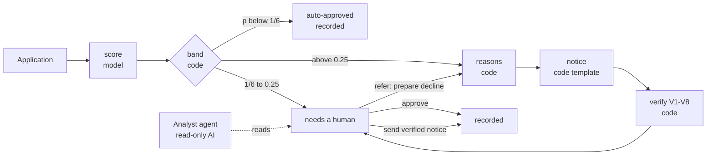

# How it works

## The decision path (no AI)

1. **Score.** `pipeline/model.py`: one-hot categoricals and standardised numerics into an L2 logistic regression, wrapped in `CalibratedClassifierCV(method="sigmoid", ensemble=False)`. `ensemble=False` keeps *one* logistic model fitted on all training rows, so the reasons come from the same coefficients that score the applicant. The calibration slope must be negative (monotone increasing); fitting fails otherwise.
2. **Band.** `pipeline/policy.py` is the only module that knows the threshold, `1 / (1 + 5)`. Exactly at the threshold the two actions tie, so the case goes to review. The refer ceiling (0.25) is a reviewer-capacity choice, not an optimum.
3. **Reasons.** `pipeline/reasons/`: for each original attribute, `Σ coef × (x − reference)` over its encoded columns, in log-odds. The reference is the mean of training applicants the model approves (n = 340 on the serving model; fallback to good-outcome rows if fewer than 50). Up to four strictly positive contributions, largest first, ties broken by name. Zero adverse contributions means *manual review*, never an invented reason.
4. **Notice.** `notice/`: a fixed frame (decision statement, ECOA paragraph per 12 CFR 1002.9(b)(1), placeholders) plus one approved sentence per reason from `reasons.yaml`, with slots filled from the applicant's fields. The reviewer can pick between two reviewed wordings but never types notice text.
5. **Verify.** `guardrails/verifier.py`: eight checks, see [the verifier](verifier.md).
6. **Decide.** `workflow/`: a plain state machine over SQLite. Every transition is one conditional `UPDATE` on status *and* revision, so a double click gets HTTP 409 instead of a second decision. The model's recommendation and the human's decision are stored separately; overriding a decline needs a comment; a notice can only be sent if its current hash is the one that passed verification.

## States

`queued → scoring → needs_review → recorded`, plus `recorded` straight from scoring for auto-approvals and `failed` (retryable). Every step appends to an event log, shown as the audit trail.

## Why no LangGraph

The decision path is short, fixed and synchronous (milliseconds). A graph framework would add checkpoints and interrupts that a state table and a revision number already provide, and would put an orchestration library on the path the import contract keeps LLM-free. See [ADR 0001](../decisions/index.md#0001-no-orchestration-framework-on-the-decision-path).
